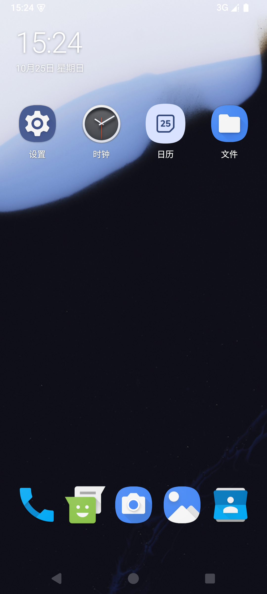
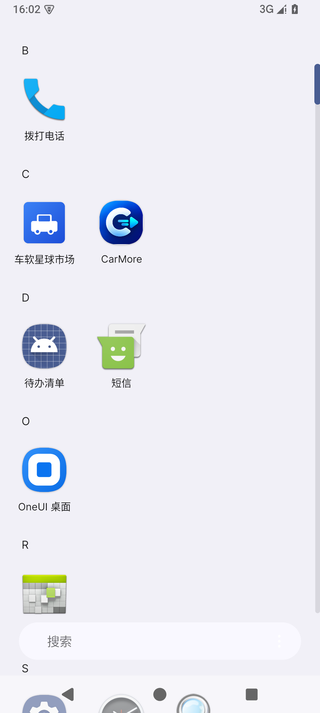
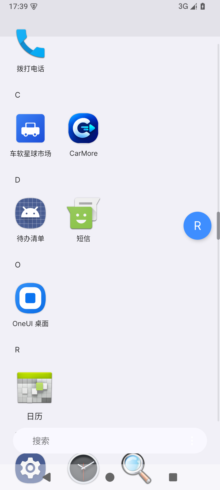
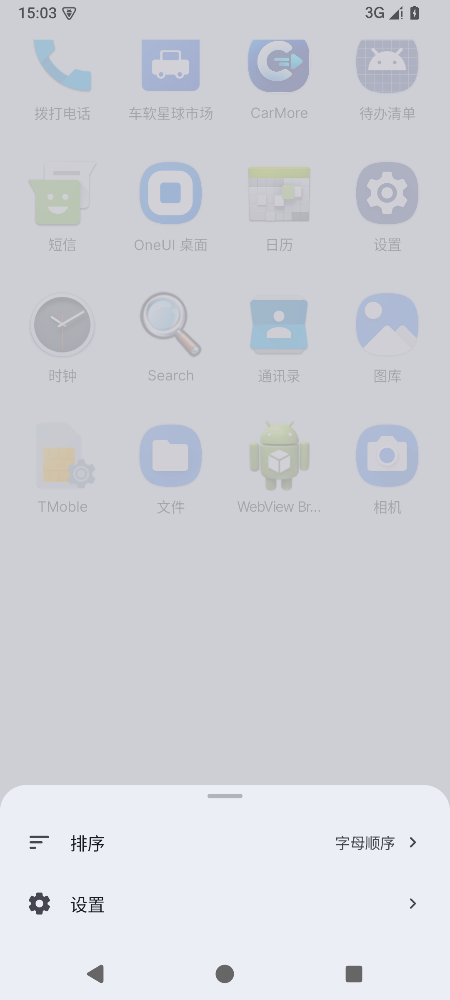

# OneUI 桌面

复刻三星 One UI 的第三方 Android 桌面启动器。

- **底层**：Lawnchair 15（Launcher3 / Android 15，Apache-2.0）
- **上层**：自研 One UI 设计层（token + 控件），SESL 只作为可选加速层，
  不引入也能保持外观一致。设计取舍见 [docs/refactor/SESL-DECISION.md](docs/refactor/SESL-DECISION.md)。

## 当前状态（第一阶段骨架）

- 桌面 **4 列 × 6 行**，Dock **5 位**
- One UI 时钟 / 日期（大号 44sp 时间 + 中文日期，随第一页滚动）
- 首屏默认排布：设置 / 时钟 / 日历 / 文件 + 电话 / 短信 / 相机 / 图库 / 通讯录
- 关闭 Lawnchair 的 smartspace 独立首屏页与 Dock 上方搜索条
- 应用抽屉：底部 One UI 搜索胶囊 + 三点菜单，键盘弹出时自动上移
- 抽屉三点菜单打开 One UI 底部菜单：排序（字母顺序 / 自定义即将支持）、设置
- 应用抽屉字母序按首字母分组（B / C / D / …），文件夹排在最前
- 抽屉右侧 One UI 索引条：3dp 细灰轨道、拖动加粗滑块、蓝色圆形字母气泡；
  行内分组标题可在设置里关闭，只保留索引
- 应用抽屉、文件夹、小组件、通知角标、最近任务沿用 Lawnchair







更多截图与验证记录见 [docs/refactor/ARCHITECTURE.md](docs/refactor/ARCHITECTURE.md)；
接手开发请先读 [docs/refactor/HANDOVER.md](docs/refactor/HANDOVER.md)。

## 构建

```powershell
# 环境（本机已配好）
$env:JAVA_HOME = 'D:\AndroidDevelopment\jdk'
$env:ANDROID_HOME = 'D:\AndroidDevelopment\Sdk'

.\gradlew.bat :assembleLawnWithQuickstepGithubDebug

# 安装并设为默认桌面
adb install -r -g build\outputs\apk\lawnWithQuickstepGithub\debug\*.apk
adb shell cmd package set-home-activity com.oneui.desktop/app.lawnchair.LawnchairLauncher
```

> 改默认布局 / 网格后要先 `adb shell pm clear com.oneui.desktop`，
> 否则旧的 `launcher_*.db` 会挡住新默认值。生效后数据库名为 `launcher_6_4_5.db`。

## 目录结构

```
src/                 Launcher3 内核（Java）
res/                 内核资源
lawnchair/src/       Lawnchair 扩展（Kotlin）
  app/lawnchair/views/OneUiClockView.kt   首屏时钟随页面滚动
lawnchair/res/       One UI 资源覆盖（优先级高于 res/）
  layout/launcher.xml              首屏根布局 + 时钟
  xml/default_workspace_4x6.xml    首屏默认排布
  xml/device_profiles.xml          4x6 / 5 Dock 网格定义
docs/refactor/       架构、SESL 决策、交接文档、验证截图
legacy/              v0.6 Compose 实现（保留作参考，不参与当前构建）
```

资源合并优先级：`lawnchair/res` > `res`。One UI 的覆盖统一写在 `lawnchair/res`，
内核 `res` 尽量不动，方便跟上游对比。

## 旧版

`legacy/` 是 v0.6 的 Jetpack Compose 实现，包含自定义排序、主屏多页、文件夹、
角标等完整交互，作为后续移植的参考。它不参与当前 Gradle 构建。

## 许可

本项目整体以 **GPL-3.0** 发布，详见 [LICENSE](LICENSE)。

其中 Launcher3 / Lawnchair 部分来自 Android Open Source Project 与 Lawnchair，
以 **Apache-2.0** 授权，详见 [LICENSE.txt](LICENSE.txt) 与 [NOTICE](NOTICE)。
所有 Apache-2.0 文件的版权头均保留。
